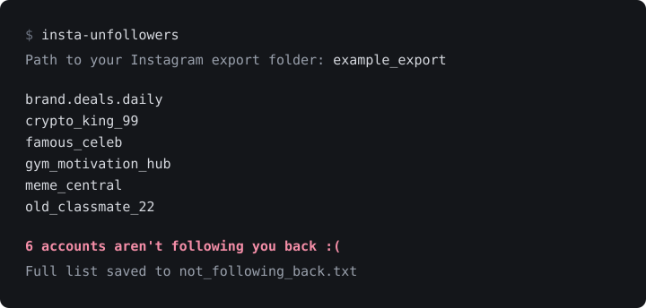

# insta-unfollowers

See who doesn't follow you back on Instagram, without giving your password to a sketchy website.




Most "unfollower" apps want your Instagram login. This one doesn't. You download your own data from Instagram, point the tool at it, and it compares the two lists on your computer. No login, no API, nothing uploaded.

## Install

You'll need Python 3.10+ and [pipx](https://pipx.pypa.io).

```bash
git clone https://github.com/tajclachar/insta-unfollowers.git
cd insta-unfollowers
pipx install .
```

## Try it

The repo comes with a fake export full of made-up accounts. From the `insta-unfollowers` folder, run:

```bash
insta-unfollowers
```

When it asks for a folder, type `example_export`.

## Use your own data

**1. Request your export.** In Instagram, go to **Settings → Meta Account → Your information and permissions → Export your information**, then:

- Click **Create Export**, pick your account, and choose **Export to Device**
- Under **Customize information**, select only **Followers and following**
- Set **Date range** to **All time** and **Format** to **HTML** (JSON won't work)
- Click **Start export**

Your download won't start right away. Meta emails you when it's ready, which can take a while.

**2. Run the tool.** Unzip the download, then run:

```bash
insta-unfollowers
```

Paste in the path to the unzipped folder. If the path has spaces in it, wrap it in quotes. You can also drag the folder into your terminal, as long as its path has no spaces.

The list prints in your terminal and gets saved to `not_following_back.txt` in whatever folder you ran the command from.

## How it works

Instagram's export includes a `following.html` file and one or more `followers_*.html` files. The tool pulls the usernames out of each and prints everyone in the first list who isn't in the second.

The whole thing is one small Python file, [`insta_unfollowers.py`](insta_unfollowers.py), so you can read exactly what it does.

## Limitations

- **It's a snapshot.** Results reflect the day you made the export, not right now.
- **Instagram can change its export format.** The tool depends on how those HTML files are structured, so an update on their end could break it.

## License

[MIT](LICENSE) © Taj Clachar
