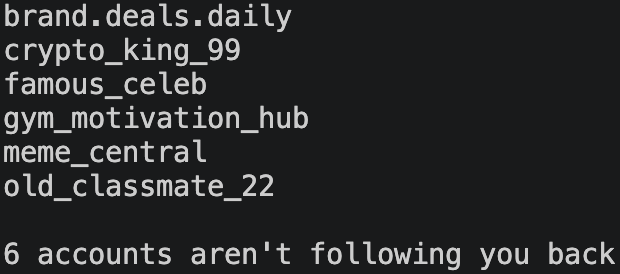

# Insta Unfollowers
Created by Taj Clachar


Insta Unfollowers is a command-line tool that can be used to find the Instagram accounts that don't follow you back. By using an export from Instagram, the program doesn't require a password or logging in. In addition, the program is completely local.



## How it Works
Instagram allows users to download a copy of their following and followers list as HTML files. This tool reads the provided files and prints every account that isn't following the user back. This list is also saved as a txt file in your current folder.

## Installation
Requires Python 3.10+ and [pipx](https://pipx.pypa.io).

```bash
git clone https://github.com/tajclachar/insta-unfollowers.git
cd insta-unfollowers
pipx install .
```

## Try it with sample data
The repo includes a fake export with made-up accounts, so you can see how it works right away:

```bash
insta-unfollowers
```

When asked for the folder, enter `example_export`.


## Using your own data
### 1. Requesting your Data
1. After logging into Instagram account open **Settings**
2. Select **Meta Account**
3. Select **Your information and permissions**
4. Select **Export your information**
5. Click **Create Export** (Choose the account)
6. Choose **Export to Device**
7. In the Customize Information window **only** select **Followers and following**. Click Save
8.  Change **Date range** to **All time** and **Format** to **HTML**
9.  Click **Start export**
> (It won't automatically download to your computer immediately so don't be alarmed if you don't see a download just yet. Meta takes time to create a download and when its ready, you'll receive an email and then you can download the zipped file to your computer)

### 2. Run it
1.  Download the file once it has been created and unzip it.
2.  Now, run the program:

```bash
insta-unfollowers
```

When asked for the path, drag the unzipped folder into the terminal and press enter. Alternatively you can paste the file path into the terminal. The results will print in the terminal and will also be saved to `not_following_back.txt` in your current folder.

## Privacy
Runs entirely on your own computer (local), so nothing is uploaded anywhere

## Known Limitations
Instagram can and has changed its export format which could break the parsing.

## License
MIT